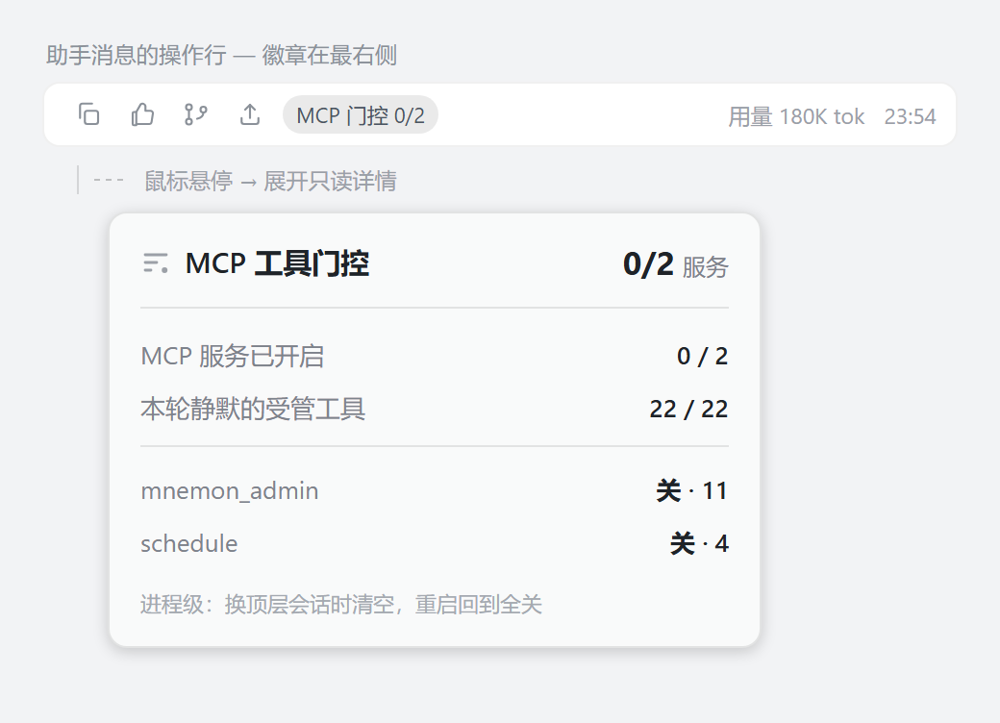

# dsh-tool-gate

[](LICENSE)
[](https://github.com/deepseek-ai)
[](package.json)

[English](README.md) | 中文

给 [DeepSeekRuntime（DSH）](https://github.com/deepseek-ai) 的 **MCP 工具**与**低频工具组**做「按需注入」：默认一个都不进提示词，任务真的需要时才开。

## 解决什么问题

MCP 服务不是「一个服务一个工具」，而是**一个服务挂几十到上百个工具**，每个工具都带完整 JSON Schema。默认全量注入时的实测数据：

| 内容 | 规模 | 每轮上下文成本 |
| --- | --- | --- |
| 单个中型 MCP 服务 | 50~100 个工具 | 数万字符 |
| 多个远程服务叠加 | 300+ 个工具 | 十万字符以上 |
| **一个常见的多服务 profile** | | **轻易达到 5 万 token 以上** |

而一次任务通常只用到其中 0~3 个工具。这个插件把这笔开销变成 0，只在任务真的需要时按服务打开。

## 安装

三种来源都支持，任选一种。

**方式一：直接从 GitHub 装（不用克隆，当前最省事）**

对 Agent 说：

```text
plugin_manager(install_bundle, target="github:Kongbaige010/dsh-tool-gate")
```

或界面操作：**插件** → **添加插件** → 粘贴 `https://github.com/Kongbaige010/dsh-tool-gate`。

**方式二：从本地目录装（开发或离线机器）**

```text
git clone https://github.com/Kongbaige010/dsh-tool-gate
plugin_manager(install_bundle, target="<克隆下来的目录绝对路径>")
```

或 **插件** → **添加插件** → 选择该目录。

**方式三：从 npm 装（发布之后）**

```text
plugin_manager(install_bundle, target="@kongbaige010/dsh-tool-gate")
```

**装好后必须重启 DSH**——插件由 Host 侧与 Client 侧两部分组成，徽章要等页面重新加载后才出现。

## 用法

注册四个元工具，也可以直接用自然语言要求：

| 工具 | 作用 |
| --- | --- |
| `mcp_services` | 列出受管服务、工具数与当前开/关状态 |
| `mcp_enable(services)` | 开启一个或多个服务（支持 `all`） |
| `mcp_disable(services)` | 关闭 |
| `tool_gate(action, group)` | 低频组（Mnemon 管理 / 定时提醒）的列出与开关 |

- **下一步生效，不是同步生效**：当前 step 的工具表已经发出去了，新开的服务要到**下一个 step**才可见、可调用——但这仍在同一次对话回合内。
- **用完即关**：没有超时机制，任务不再需要时由模型 `mcp_disable` 关闭；需要时再开一次的成本只有一步。

## 徽章

每条助手回复的操作行末尾会多一枚只读徽章，鼠标悬停即展开只读详情：



- `0/2` = 受管服务里开了几个（图中为 2 个受管、0 个已开）；
- 悬停看明细：已开启服务、本轮静默的工具数、低频组状态；
- 点击立即重新拉取（默认每 20 秒轮询一次）。

徽章只做显示，不改变门控行为。它读两个只读 GET 端点：`/plugin/tool-gate/mcp` 与 `/plugin/tool-gate/groups`。

## 固定入口

DSH 桌面宿主以 `--port 0` 启动，每次重启都换端口，旧书签/旧标签页会失效。插件在监听就绪后把**当前实例的带令牌地址**写入 `~/.dsh/web-url.txt`，配合一个很短的启动脚本即可一键打开当前实例：

```bat
@echo off
setlocal
set "F=%USERPROFILE%\.dsh\web-url.txt"
if not exist "%F%" goto missing
set /p URL=<"%F%"
start "" "%URL%"
exit /b 0
:missing
echo No recorded address. Start DSH once first.
pause
```

> 该文件含浏览器访问令牌，请只放在自己的用户目录，不要提交到仓库或同步到公开位置。

## 原理

1. **Host 侧**包住 `systemPrompt.assemble()`：先调用原方法拿到含 `tools` 的完整装配结果，再把「已关闭服务」的 schema 裁掉。
   它**刻意不**监听 `system-prompt/assemble` 瀑布：新版权 `dsh-system-prompt` 把 `tools` 放在瀑布返回之后才合并，`assembly.tools` 在那里恒为 `undefined`，照它写的过滤器会静默失效、一个 schema 都不裁（这就是 0.2 修掉的那个 bug）。
2. **Client 侧**往 `conversation.chat.assistant-actions`（list 插槽）追加一枚 chip。只读、不做绝对定位；任何失败都降级成 `MCP ?` 而不是抛错——slot 条目一旦抛错，整行会变空白。

## 配置

在 profile 的 `cordis.patch.yml` 里覆盖本插件的 `config`：

```yaml
- id: tool-gate
  config:
    mcp:
      gated: [my-server, another-server]   # 可选；省略=自动管理所有 MCP 服务
      catalog:                      # 可选：仅给 mcp_services 的输出补充说明文字
        my-server: { title: '我的服务', use: '它能做什么' }
      alwaysVisible: []             # 即使受管也始终可见的工具名
      hint: true                    # 是否注入那行系统提示
      idleTtlMs: 0                  # >0 时空闲兜底自动关闭（毫秒），默认 0=纯手动
    groups:
      alwaysVisible: []
      hint: true
```

## 安全与限制

- 两个状态端点**不经过** GUI 的令牌认证。它们只读、只监听 loopback、响应 `no-store`；没有设置 CORS 头，所以网页跨源读不到内容，但本机其它进程能读到。介意的话请自行加同源校验或删除这两条路由。
- `~/.dsh/web-url.txt` 是明文令牌（与 `~/.dsh/.credentials.yaml` 同一信任级别）。
- **隐藏 ≠ 禁用**：被门控的工具仍在注册表里、执行通道完好，模型若从历史中记得名字仍可能调用成功。要让执行也拦住，需叠加 `tools.restrict()` / `tools.guard()`。
- **门控粒度是服务**，不是单个工具：为一个小功能开一个服务，仍要付它全部 schema 的成本。
- Host 侧是猴补丁，依赖 `systemPrompt.assemble` 这个方法名。DSH 大版本升级后，请看徽章悬停里的「静默 N」是否仍非零。
- 零依赖、无安装脚本、无 `child_process`、无 `eval`；唯一写入的文件是 `~/.dsh/web-url.txt`。

## 已验证环境

- DSH `0.2.2-rc.3`（Windows x64 桌面版，Web 界面）
- 多个 MCP 服务（本地 stdio 与远程 streamable-http 混合），工具数以百计

## License

MIT
