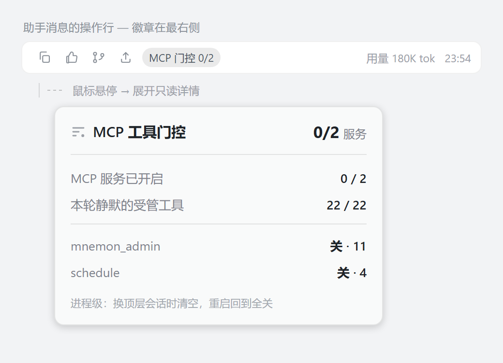

# dsh-tool-gate [](https://github.com/deepseek-ai/deepseek-harness)

[](https://www.npmjs.com/package/@kongbaige010/dsh-tool-gate) [](https://www.npmjs.com/package/@kongbaige010/dsh-tool-gate) [](https://github.com/Kongbaige010/dsh-tool-gate)
[](LICENSE) [](https://github.com/deepseek-ai) [](package.json)

**English** · [中文](README.md)

Tool gating for [DeepSeekRuntime (DSH)](https://github.com/deepseek-ai): **MCP tool schemas** and **low-frequency tool groups** stay out of the prompt by default, and are opened only when a task actually needs them.

## The problem it solves

An MCP server is not "one server, one tool" — it ships dozens to hundreds of tools, each with a full JSON Schema. Measured on a real profile with the default full injection:

| Content | Size | Prompt cost per turn |
| --- | --- | --- |
| One mid-sized MCP server | 50–100 tools | tens of thousands of characters |
| Several remote servers stacked | 300+ tools | well over 100k characters |
| **A typical multi-server profile** | | **easily 50k+ tokens** |

A task usually needs 0–3 of them. This plugin turns that cost into 0 and opens a server only when the task actually asks for it.

## Install

Three sources work; pick one.

**1. Straight from GitHub (no clone, recommended today)**

Ask the agent:

```text
plugin_manager(install_bundle, target="github:Kongbaige010/dsh-tool-gate")
```

or in the UI: **Plugins** → **Add plugin** → paste `https://github.com/Kongbaige010/dsh-tool-gate`.

**2. From a local directory** (for development or offline machines)

```text
git clone https://github.com/Kongbaige010/dsh-tool-gate
plugin_manager(install_bundle, target="<absolute path to the cloned directory>")
```

or **Plugins** → **Add plugin** → choose that directory.

**3. From npm** (once published)

```text
plugin_manager(install_bundle, target="@kongbaige010/dsh-tool-gate")
```

**Restart DSH after installing** — the bundle has a Host half and a Client half, and the badge appears only after the page reloads.

## Usage

Four meta tools are registered; you can also just ask in natural language:

| Tool | Purpose |
| --- | --- |
| `mcp_services` | list the managed servers, their tool counts and open/closed state |
| `mcp_enable(services)` | open one or more services (`all` supported) |
| `mcp_disable(services)` | close them |
| `tool_gate(action, group)` | list/open/close low-frequency groups (Mnemon admin, schedules) |

- **Next step, not this step**: the tool table of the current step has already been sent, so a newly opened service becomes visible and callable at the **next step** — within the same conversation turn.
- **Close it when done**: there is no timer. The model closes the service with `mcp_disable` when the task no longer needs it; reopening later costs one step.

## The badge

Every assistant message gets one read-only chip at the end of its action row; hovering it opens a read-only detail card:



- `0/2` — how many of the managed servers are open (2 managed, 0 open in the picture);
- hover shows the detail: open servers, tools silenced this turn, low-frequency group state;
- click re-fetches immediately (otherwise polled every 20 s).

It is display-only. It reads two read-only GET endpoints: `/plugin/tool-gate/mcp` and `/plugin/tool-gate/groups`.

## Fixed entry point

The Desktop host starts with `--port 0`, so the port changes on every restart and old bookmarks or tabs die. Once the listener is up, this bundle writes the **authenticated URL of the current instance** to `~/.dsh/web-url.txt`, which a tiny launcher can open:

```bat
@echo off
setlocal
set "F=%USERPROFILE%\.dsh\web-url.txt"
if not exist "%F%" goto missing
set /p URL=<"%F%"
start "" "%URL%"
exit /b 0
:missing
echo No recorded address. Start DSH once first.
pause
```

> That file contains the browser access token. Keep it in your own profile directory; never commit or sync it to a public place.

## How it works

1. **Host** wraps `systemPrompt.assemble()`: it calls the original method to get the complete assembly (with `tools`), then drops the schemas of servers that are managed **and** not open.
   **It only ever removes servers it manages itself.** The managed set starts empty, so the gate removes nothing and behaves exactly like no plugin being installed; only servers listed in `gated`, or added at runtime through `mcp_gate`, are managed. That way it never overrides somebody else's visibility decision (`reveal` / `restrict` / a permission plugin) — 0.3.0 silently swallowed all 18 `windows` desktop-control tools precisely because it claimed every MCP server by default.
   It deliberately does **not** listen on the `system-prompt/assemble` waterfall: current `dsh-system-prompt` builds `tools` **after** that waterfall resolves, so `assembly.tools` is always `undefined` there and a filter written against it silently keeps every schema. (That was the bug fixed in 0.2.) **This is not a style preference — it is the only interception point that can see the tools.**
2. **Client** appends one chip to the `conversation.chat.assistant-actions` list slot. Read-only, no absolute positioning, and every failure degrades to `MCP ?` instead of throwing — a throwing slot entry would blank its row.

## Configuration

Override the plugin `config` in the profile's `cordis.patch.yml`:

```yaml
- id: tool-gate
  config:
    mcp:
      gated: [my-server, another-server]   # managed servers; omit = manage nothing (gate idles)
      defaultEnabled: []                   # open by default once managed; omit = managed means closed
      catalog:                      # optional display text for mcp_services
        my-server: { title: 'My server', use: 'what it can do' }
      alwaysVisible: []             # tool names always visible even when managed
      hint: true                    # inject the one-line system prompt hint
      idleTtlMs: 0                  # >0 enables an idle safety net (ms); 0 = manual only
    groups:
      alwaysVisible: []
      hint: true
```

The managed set can also change at runtime without a restart: `mcp_gate(action="manage", services="my-server")` to add, `unmanage` to remove, `clear` to reset, `list` to inspect.

## Security and limitations

- The two status endpoints are **not** behind the GUI token check. They are read-only, bind to loopback only, and send `no-store`; no CORS header is set, so a web page cannot read them cross-origin. Other local processes still can. Add same-origin validation or delete the routes if that matters to you.
- `~/.dsh/web-url.txt` contains a browser token in plain text (same trust level as `~/.dsh/.credentials.yaml`).
- **Hidden is not disabled**: a gated tool stays registered and executable; a model that remembers the name from history may still call it. Combine with `tools.restrict()` / `tools.guard()` if you need execution to be blocked too.
- **Nothing is gated by default**: with an empty `gated` list the plugin removes no schemas at all. Quota saving only starts once you manage something; host capabilities such as `windows` (desktop control) and `cad` (CAD preview) must be named explicitly, so a model never loses basic tools without any hint.
- **The unit of gating is a server**, not an individual tool: opening a server for one small feature still costs every schema it ships.
- The Host half monkey-patches `systemPrompt.assemble`; it depends on that method name. After a major DSH upgrade, check that the badge tooltip still reports a non-zero "silenced" count.
- Zero dependencies, no install scripts, no `child_process`, no `eval`. The only file it writes is `~/.dsh/web-url.txt`.

## Verified on

- DSH `0.2.2-rc.3` (Windows x64 desktop build, Web UI)
- Multiple MCP servers (local stdio and remote streamable-http), hundreds of tools in total

## License

MIT
