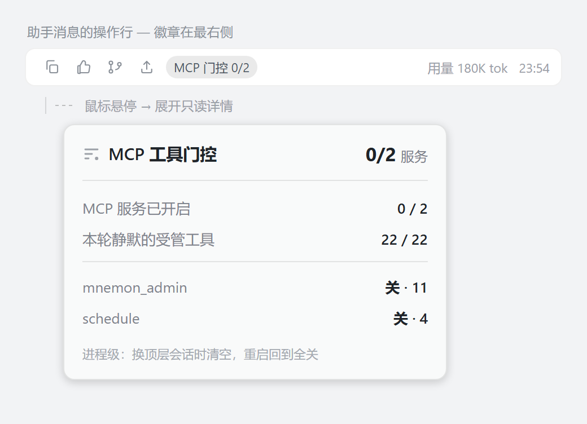

# Tool gate (MCP + low-frequency tools)

## What it does

Removes the JSON Schemas of managed tools from every prompt and puts them back only when a task needs them:

- **MCP**: every managed server's tools are silenced by default (tens of thousands of tokens per turn down to 0);
- **Low-frequency groups**: listed by configuration (defaults to `mnemon_admin` and `schedule`), also silenced by default.

## How to use it

| Meta tool | Purpose |
| --- | --- |
| `mcp_services` | list managed servers, tool counts, open/closed state, plus a diagnostic line |
| `mcp_enable("my-server")` | open (comma-separated, or `all`) |
| `mcp_disable("my-server")` | close |
| `tool_gate("list" / "enable" / "disable", group)` | low-frequency groups |

- **Takes effect at the next step**: the tool table of the current step has already been sent, so a newly opened service is visible and callable at the next step — within the same conversation turn.
- **Close when done**: there is no timer by default; the model closes the service when the task ends. `idleTtlMs > 0` enables an idle safety net.
- State is **process-wide**: shared by all sessions and subagents, cleared when a new top-level session starts, and back to "all closed" after a restart.

## Badge

At the end of the assistant action row; hovering opens the read-only detail card:

- hover: open servers, tools silenced this turn, low-frequency group state;
- click: refresh immediately (otherwise polled every 20 s);
- read-only: it displays, it does not toggle anything.

## Read-only endpoints

| Endpoint | Returns |
| --- | --- |
| `/plugin/tool-gate/mcp` | `opened`, `servers`, `injected`, `hidden`, `total`, `idleTtlMinutes`, `autoClosed`, `assembleCount`, `knownCount`, `ready` |
| `/plugin/tool-gate/groups` | `opened`, `groups[{name, enabled, tools}]`, `assembleCount` |

`ready: false` means the host has not completed its first assembly yet; the badge then shows `MCP …` instead of a misleading 0/0.

## Fixed entry point

The Desktop host starts with `--port 0`, so the port changes on every restart. Once the listener is up, the bundle writes the authenticated URL of the current instance to `~/.dsh/web-url.txt`, which a short launcher can open. That file contains an access token and should never leave the local profile directory.

## Limitations

- Hidden is not disabled: registration and execution stay intact, so a model that remembers the name can still call the tool.
- The unit of gating is a server, not an individual tool.
- The status endpoints are read-only but unauthenticated (loopback only, no CORS header).
- The Host half monkey-patches `systemPrompt.assemble`; re-verify after a major DSH upgrade by checking that the badge tooltip still reports a non-zero silenced count.
