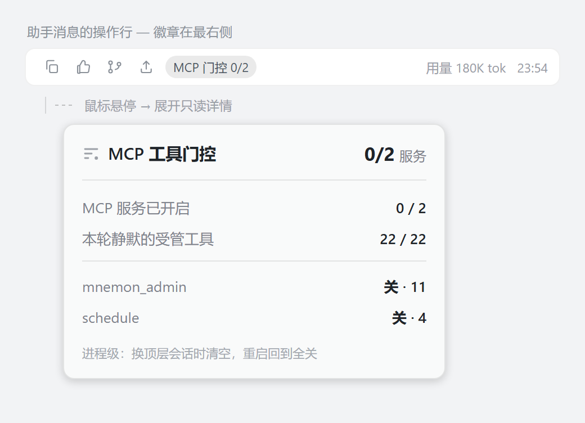

# 工具门控（MCP + 低频工具）

## 做什么

把「受管工具」的 JSON Schema 从每轮提示词里拿掉，需要时再放回去：

- **MCP**：所有受管服务的工具默认全静默（数万 token/轮 → 0）；
- **低频工具组**：由配置列出（默认 `mnemon_admin`、`schedule` 两组），默认全静默。

## 怎么用

| 元工具 | 说明 |
| --- | --- |
| `mcp_services` | 列出受管服务、工具数、开/关状态，附诊断行 |
| `mcp_enable("my-server")` | 开启（可逗号分隔或 `all`） |
| `mcp_disable("my-server")` | 关闭 |
| `tool_gate("list" / "enable" / "disable", group)` | 低频组开关 |

- **下一步生效**：同一 step 的工具表已发出，开启后到下一个 step 才可见、可调用（同一次对话内即可完成）。
- **用完即关**：默认没有超时，由模型在任务结束时主动关闭；`idleTtlMs > 0` 时才有空闲兜底。
- 状态是**进程级**的：所有会话与子代理共享，换顶层会话清空，重启回到全关。

## 徽章

助手消息下方的操作行末尾，鼠标悬停展开只读详情：

- 悬停明细：已开启服务、本轮静默工具数、低频组状态；
- 点击立即刷新（默认 20 秒轮询一次）；
- 只读：只显示，不提供开关。

## 只读端点

| 端点 | 返回 |
| --- | --- |
| `/plugin/tool-gate/mcp` | `opened`、`servers`、`injected`、`hidden`、`total`、`idleTtlMinutes`、`autoClosed`、`assembleCount`、`knownCount`、`ready` |
| `/plugin/tool-gate/groups` | `opened`、`groups[{name, enabled, tools}]`、`assembleCount` |

`ready: false` 表示宿主还没完成第一次装配（此时徽章显示 `MCP …` 而不是误导性的 0/0）。

## 固定入口

桌面宿主以 `--port 0` 启动，端口每次重启都变。插件在监听就绪后把带令牌的当前地址写入 `~/.dsh/web-url.txt`；配套一个短脚本即可一键打开当前实例。该文件含访问令牌，只应留在本机用户目录。

## 限制

- 隐藏 ≠ 禁用：注册表与执行通道不变，模型若记得工具名仍可调用。
- 门控粒度是服务，不是单个工具。
- 状态端点是只读但**无鉴权**（仅 loopback）。
- 猴补丁依赖 `systemPrompt.assemble` 方法名，DSH 大版本升级后需复验（看徽章悬停的「静默 N」是否非零）。
